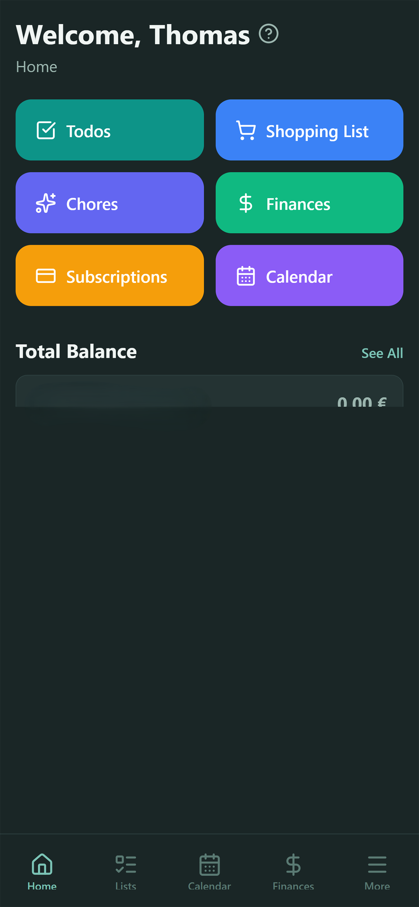
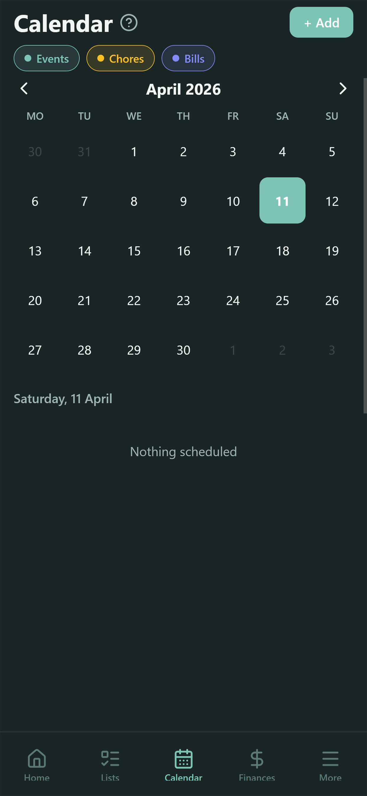
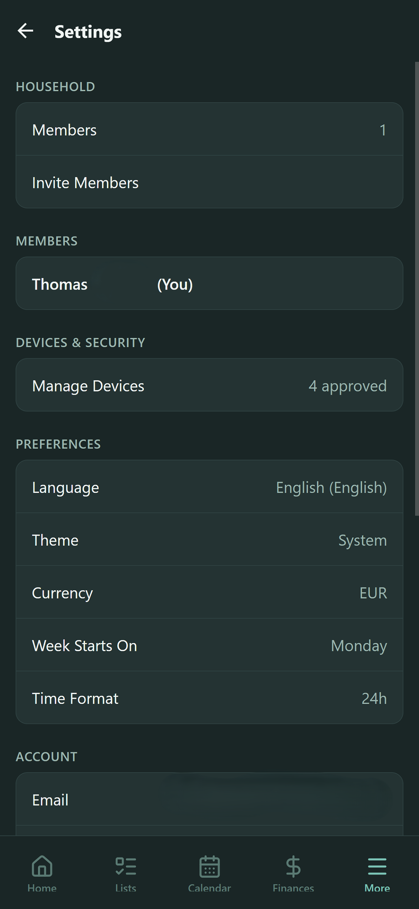
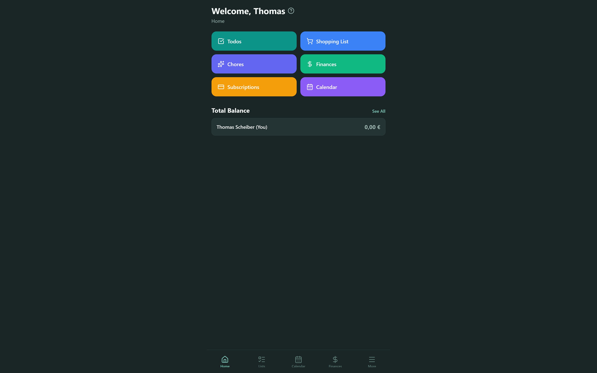

# Wohnly

Wohnly is a household app for people who share a flat or a family home. One household holds the shared expenses, chores, shopping lists, calendar, todos and subscriptions of everyone who lives there. Titles, descriptions and similar text are encrypted on the device before they reach the server.

The app runs on iOS, iPadOS, Android, macOS, Windows and the web from one TypeScript codebase. The site is [wohnly.app](https://wohnly.app).

Store listings I can verify from this repository:

- [App Store](https://apps.apple.com/app/wohnly/id6761035211), which the app also links for macOS
- [Microsoft Store](https://apps.microsoft.com/detail/9P5JTRSRMJPB)

Android builds go to a Google Play closed testing track named "First Test" (`eas.json`). The repo has no public Play Store link, and the Play Store page for the package `app.wohnly` returned 404 when I checked, so I do not claim a public Android listing.

<p>
  
  
  
</p>
<p>
  
</p>

## What it does

Everything below is a route in `apps/api/src/routes` plus a screen in `apps/mobile/app`.

**Expenses.** A household member records an expense with an amount, a currency and a category. The split is equal, by percentage or by fixed amounts. Expenses can have line items, and each line item can be assigned to members. Expenses take file attachments. The phone can scan a receipt with on-device text recognition (Apple Vision on iOS, Google ML Kit on Android) and parse the result. The API computes balances per member, a simplified settle-up list of who pays whom, spending analytics by category and member, and an export. Rates for foreign currencies come from `open.er-api.com` and are cached in the database. A household has a base currency.

**Subscriptions.** Recurring bills (weekly, biweekly, monthly, quarterly or yearly) with an amount, a billing date and a split between members. Billing dates show up in the calendar.

**Chores.** A chore repeats daily, weekly, biweekly or monthly, with an effort weight from 1 to 5. It can rotate between the assigned members each cycle. Members complete chores, send a nudge to the assignees, and compare points on a leaderboard. An analytics endpoint summarises who did what.

**Shopping lists.** Items with quantities and a suggestions endpoint. A meal plan (breakfast, lunch, dinner, snack, with a recipe and an ingredient list) can push its ingredients to the shopping list.

**Todos.** Shared household todos with assignees, and a separate personal todo list that only its owner sees.

**Calendar.** Household events with attendees and reminders. The calendar also shows chores and bill dates. The app can read device calendars through `expo-calendar`. The API syncs both ways with Google Calendar.

**Members and households.** A user creates a household or joins by invitation code. The owner can change roles. A household has a break mode with a start and end date. Leaving a household needs an email confirmation. Deleting a household needs the approval of the other members. Account deletion is available in the app and through `DELETE /api/user/account`.

**Live updates and notifications.** The API pushes changes over server-sent events (`/api/stream`). Push tokens are stored for Expo push notifications.

**Widgets.** An iOS WidgetKit extension in `apps/mobile/targets/widget`, Android widgets through `react-native-android-widget`, and Windows widgets declared in `apps/desktop/manifest.json`. The API serves the widget data at `/api/widgets/todos`, `/calendar` and `/shopping`.

**Languages.** 42 languages, one JSON file each in `apps/mobile/i18n`.

**Pro.** An optional lifetime purchase named "Wohnly Pro" removes ads. Mobile purchases go through RevenueCat. The API also has RevenueCat and Stripe webhook routes. Free users see AdMob banners on native and an AdSense banner on web and desktop.

## How the encryption works

The client code is in `apps/mobile/lib/crypto`. It uses libsodium, loaded through `react-native-libsodium` on native and `libsodium-wrappers` on web.

**What is encrypted.** `encrypt-service.ts` encrypts the free text of todos, shopping items, chores, events, expenses, expense attachments and subscriptions. For a todo that is the title and description. For an event it also includes the location. The client puts the fields into one JSON string, encrypts it with XChaCha20-Poly1305 using a random nonce, and stores the result in the original `title` or `name` column. The row also gets `encrypted = true`, the `nonce` and the `encryptionEpoch` of the key it used. The server cannot read those fields.

**What is not encrypted.** Amounts, currencies, dates, categories, frequencies, split types, member relations and the household structure stay readable. The API needs them to compute balances, send reminders and serve widgets. Meal plans have `nonce` columns in the schema, but `encrypt-service.ts` has no function for them, so I do not claim they are encrypted.

**Keys.** Each device generates an X25519 key pair on first use. The private key stays on the device, in `expo-secure-store` on native and IndexedDB on web. The household has one random symmetric key. The server only stores copies of that key that are sealed to a device's public key with `crypto_box_seal` (table `HouseholdKeyEnvelope`, one row per device and key epoch). A separate random personal key, sealed per device in the same way, covers a user's personal data.

**A new device.** A new device or a new member sends an access request (`POST /api/access/requests`) with its public key. The API creates a six digit code and stores only a SHA-256 hash of it. The code shows on the new device. A member whose device already holds the key types it in on an approved device. That device seals the household key to the new public key and sends the sealed key together with the code to `POST /api/access/requests/:id/approve`. The API compares the code in constant time and stores the envelope only if it matches. Five wrong tries expire the request, and the endpoint is rate limited. The new device then downloads its envelope and unseals it. Missing envelopes can also be uploaded later through `POST /api/households/:id/envelopes`.

**Rotation.** When a member or a device is removed, or the owner asks for it (`/epochs/rotate`), the household moves to the next key epoch. A remaining device generates the new key, seals it to every approved device and commits it through `/epochs/commit`. The table `EpochRotation` tracks each attempt. Rows record the epoch they were encrypted with, so old content stays readable with the old key.

**Server side.** `apps/api/src/lib/crypto.ts` has an AES-256-GCM helper keyed by `ENCRYPTION_KEY`. Nothing in `apps/api/src` calls it right now, and the Prisma schema comment on the calendar sync token says it is encrypted with it. Treat it as unused until that changes. The recovery steps for stuck key distribution are in `docs/ops`.

## The story

I wrote the first version of Wohnly as a progressive web app. I rebuilt it as a native app, partly because I wanted to find out what it takes to publish an app to the stores.

The history in this repository starts on 2026-03-17 with a `create-expo-app` template. Four days later, on 2026-03-21, one commit moves the app over from the earlier Next.js PWA, which the commit message calls "haushoit". It replaces Clerk with Better Auth, MySQL with PostgreSQL and the Next.js frontend with Expo and Hono. That commit already contains the XChaCha20-Poly1305 and X25519 code, and the app had two languages, English and German. The Tauri desktop wrapper arrived on 2026-03-28. As of 2026-09-23 the history has 386 commits.

### What publishing took

This is what the repository shows, in order.

- **One build setup per platform.** Expo and EAS build the iOS and Android apps. Tauri builds the macOS and Windows apps from the same Expo web export. The web app is that export served by Caddy. The repo has 11 GitHub Actions workflows, including four for macOS App Store Connect.
- **First review, April 2026.** The first iOS submission, version 1.2.0 build 8, was rejected on 2026-04-14. A PDF of the App Store Connect message is in `iOSlistings/report files`. It cites four guidelines: an unreachable support URL, buttons that failed on an iPad Air, unclear camera and photo purpose strings, and an error in the in-app purchase screen. A commit the same day is titled "resolve App Store, MS Store, and Play Store submission issues".
- **Version numbers.** On 2026-04-18 I switched EAS to remote version numbers (`appVersionSource: remote`) because CI builds collided. The release commits then run through 1.3.2 and 1.3.3 (2026-05-19), 1.3.4 (2026-06-21), 1.3.5 (2026-07-18) and 1.4.0 (2026-09-22).
- **Windows.** The first plan was an MSI installer. On 2026-04-07 I dropped MSI for NSIS and removed an Azure Trusted Signing step, because the Microsoft Store signs packages itself. On 2026-04-10 Windows distribution moved to an MSIX package for the Microsoft Store (`apps/desktop/build-msix.ps1`). The workflow uploads it as an artifact, and I upload it by hand in Partner Center, because the Store account has no Microsoft Entra tenant for automated publishing. A Store certification report with a screenshot is kept in `MSStorelistings`.
- **Desktop updater.** Direct-download builds of the desktop app check `latest.json` on the `desktop-latest` GitHub release and verify a signature. The Mac App Store build sets `createUpdaterArtifacts` to false and has no updater, because the Store delivers updates.
- **Code signing.** The macOS workflow signs and notarizes the app. The repository's `.gitignore` excludes signing material such as `.p8`, `.p12` and `.mobileprovision` files.
- **Mac App Store review.** `docs/app-store/macos-review-notes.md` has seven entries between 2026-05-29 and 2026-08-10, with builds from 1.3.3 to 1.3.12. The first rejections were about Sign in with Apple opening a browser. The later ones were about the native sign-in failing. The fix was a native `AuthenticationServices` sheet, an in-app fallback and Better Auth's bearer token plugin. The last round also found a Sign Out button that did nothing, because WKWebView did not show a browser `confirm()` dialog. In August I added the four `asc-macos-*` workflows to resubmit, inspect TestFlight builds and upload a candidate gated on a checksum.
- **Google Play.** Closed testing submission arrived on 2026-06-21. `data_safety_import.csv` holds the data safety form answers, 156 rows, in the format Play Console imports.
- **Store listings.** `iOSlistings` has 7 iPhone screenshots, `iPadOSlistings` 6, `MacOSlistings` 8 and `Androidlistings` 6. `MSStorelistings` has one listing CSV for each of 42 languages, plus scripts that generate them.

## Architecture

```text
apps/mobile (Expo, React Native) --+
apps/desktop/tauri (Tauri 2, Rust) --+--> HTTPS --> apps/api (Hono) --> PostgreSQL
web export of apps/mobile ---------+            |
                                                +--> SSE stream, push, email, webhooks
```

The Tauri app wraps the web export from `apps/mobile/dist`. In development it loads `http://localhost:8081`. The clients read the API address from `expo.extra.apiUrl` in `apps/mobile/app.json`, which is `https://api.wohnly.app`.

Versions below come from the manifests and the installed lockfile on 2026-11-12.

| Part | Technology |
| --- | --- |
| API | Hono 4.13 on `@hono/node-server` 2.1, Node.js, TypeScript 6.0 |
| Database | PostgreSQL through Prisma 7.10 with `@prisma/adapter-pg`, 40 models in `schema.prisma` |
| Auth | Better Auth 1.7 with email, Google and Apple sign-in |
| Mobile and web | Expo 57, React Native 0.86, React 19.2, Expo Router 57 |
| Desktop | Tauri 2.11 with the shell, deep-link, updater and process plugins |
| Client state | TanStack Query 5 |
| Validation | Zod 4, shared between API and clients in `packages/shared` |
| i18n | i18next 26 and react-i18next 17 |
| Encryption | libsodium (`react-native-libsodium` 1.7, `libsodium-wrappers` 0.8) |
| Payments and ads | RevenueCat (`react-native-purchases` 10.4), Stripe 22, AdMob |
| Hosting | API on a VPS with PM2 and Caddy, web export on the same VPS |
| CI | GitHub Actions, EAS Build, Renovate |

CI and EAS builds run on Node.js 24.

### Project structure

```text
apps/
  api/            Hono API
    src/routes/   one file per resource
    src/lib/      email, push, splits, rate limiting, SSE registry
    prisma/       schema.prisma
    scripts/      node:test suites
  mobile/         Expo app for iOS, Android and web
    app/          Expo Router screens
    lib/          API client, auth, crypto, widgets, OCR, payments
    i18n/         42 language files
    targets/      iOS widget extension
  desktop/        Tauri wrapper, PWA manifest, MSIX packaging
packages/shared/  Zod schemas, types and utilities
deploy/           Caddyfile, PM2 config, health check, database backup
docs/             operations runbooks, App Review notes, design notes
```

## Run it locally

You need Node.js and npm (CI and EAS use Node.js 24) and a PostgreSQL server. Native builds also need Xcode or Android Studio. Desktop builds need a Rust toolchain.

```bash
npm install
cp apps/api/.env.example apps/api/.env
```

Edit `apps/api/.env`. `DATABASE_URL`, `BETTER_AUTH_URL` (`http://localhost:3001`) and `BETTER_AUTH_SECRET` are the minimum. Google and Apple OAuth, SMTP, RevenueCat and Stripe stay empty if you do not use them.

The repository has no Prisma migrations folder, so create the tables with `db:push`.

```bash
npm run db:generate
npm run db:push
npm run dev:api
```

The API listens on port 3001 unless `PORT` is set. `npm run api:health` checks a running API.

The mobile app points at `https://api.wohnly.app` by default. To use your local API, change `expo.extra.apiUrl` in `apps/mobile/app.json` to `http://localhost:3001`, then start Expo.

```bash
npm run dev:mobile
```

Press `w` for the web app, `i` for the iOS Simulator or `a` for an Android emulator. Copy `apps/mobile/.env.example` to `apps/mobile/.env` for the RevenueCat and ad keys. In-app purchases only work with real RevenueCat keys, and `EXPO_PUBLIC_PAYWALL_PREVIEW=true` shows the paywall without them.

For the desktop app, start the web server with `npm run dev:mobile`, then run `npx tauri dev` inside `apps/desktop/tauri`.

### Checks and tests

```bash
npm run typecheck   # tsc over apps/mobile
npm run lint        # expo lint for the app, tsc for packages/shared
npm test            # node:test suites in apps/api/scripts
```

`npm test` needs the Prisma client, so run `npm run db:generate` first. Generating does not need a database, but `DATABASE_URL` must be set to any valid URL.

### Environment variables

The API reads these from `apps/api/.env`. The list is the template in `apps/api/.env.example` plus the names the code reads that the template leaves out.

| Variable | Used for |
| --- | --- |
| `DATABASE_URL` | PostgreSQL connection |
| `BETTER_AUTH_URL`, `BETTER_AUTH_SECRET` | Auth base URL and session secret |
| `GOOGLE_CLIENT_ID`, `GOOGLE_CLIENT_SECRET` | Google sign-in and Calendar sync |
| `APPLE_CLIENT_ID`, `APPLE_CLIENT_SECRET` | Apple sign-in |
| `APPLE_TEAM_ID`, `APPLE_KEY_ID`, `APPLE_PRIVATE_KEY_PATH` | Signing key that renews the Apple client secret |
| `SMTP_HOST`, `SMTP_PORT`, `SMTP_USER`, `SMTP_PASSWORD`, `EMAIL_FROM` | Outgoing email |
| `REVENUECAT_WEBHOOK_SECRET`, `STRIPE_SECRET_KEY`, `STRIPE_WEBHOOK_SECRET` | Payment webhooks |
| `ENCRYPTION_KEY` | Key for the AES-256-GCM helper |
| `WOHNLY_MIN_APP_VERSION`, `WOHNLY_CURRENT_APP_VERSION` | Minimum app version the API accepts |

## Deployment

Workflows under `.github/workflows` deploy on pushes to `main`. The API workflow runs on changes to `apps/api` or `packages/shared`, and the web workflow on changes to `apps/mobile` or `packages/shared`. Mobile builds run through EAS from `deploy-mobile.yml`, and desktop builds from `deploy-desktop.yml`. `deploy/` holds the Caddyfile, the PM2 config, a health check script and a database backup script.
